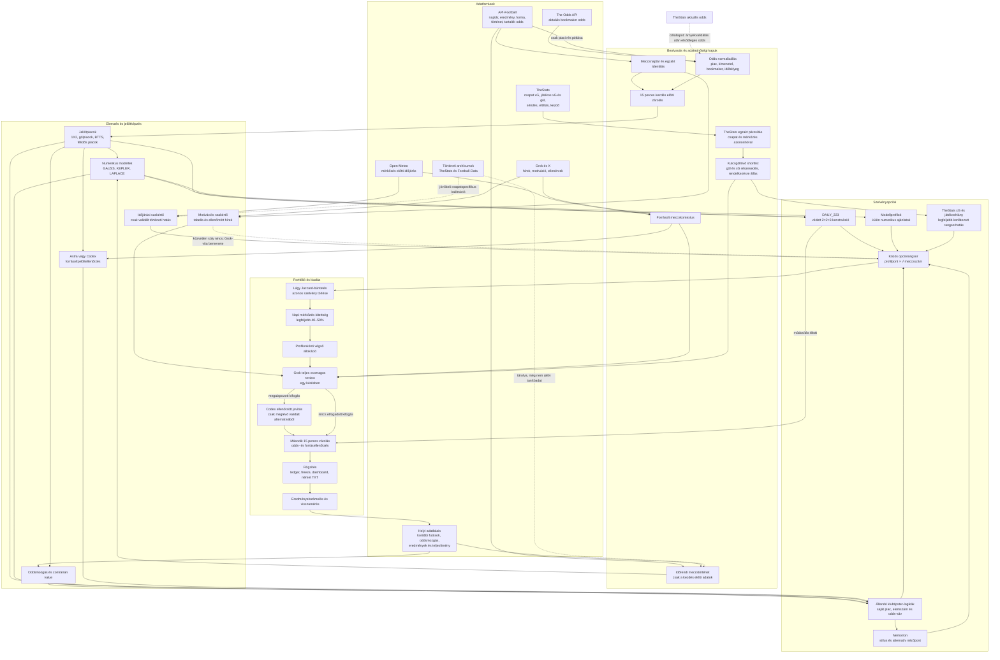

# Arthur szelvény-előállítási folyamat

Állapot: 2026-10-18. A folytonos nyíl aktív döntési útvonalat, a szaggatott
nyíl tárolt vagy csak tanácsadói adatot jelöl. A `DAILY_223` ág védett.

## A felülvizsgálat eredménye

### Aktívan használt adatok

- API-Football mérkőzések és időrendi történet: jelöltkészlet és numerikus
  modellek.
- The Odds API, valamint hiány esetén API-Football odds: jelenlegi piaci
  jelöltek és szorzók.
- TheStats csapat-xG: a nem védett opciók rangsorolási keresztellenőrzése.
- TheStats játékospiac, játékos gól/xG és igazolt hiányzás: kulcstámadó
  kiválasztása, támadó részesedés és korlátozott xG-rangsorkorrekció.
- Open-Meteo: csak forrásolt, kezdés előtti és történetileg validált
  időjárási hatásnál ad rangsorolási súlyt.
- Helyi odds-pillanatképek: ármozgás és contrarian value.
- Astra/Codex ellenőrzés: jelöltbizonyíték és vétófelülbírálási kontroll.
- Grok: a teljes kész csomag egyszeri ellenőrzése; önmagában nem írhat át
  szelvényt.

### Beolvasott, de még nem közvetlen modellbemenet

- A TheStats és Football-Data történeti archívum jelenleg tárolódik, de még
  nincs egységes azonosítókkal összefűzve a napi tanítóhalmazzal.
- A motivációs/humán szakértő közvetlen numerikus súlya nulla; az információ a
  Grok-csomagba kerül, és csak forrásolt kifogás plusz Codex-egyetértés után
  okozhat cserét.
- A TheStats aktuális odds még nem a jelöltképzés első forrása. Előbb igazolni
  kell az esemény-, piac-, bookmaker- és időbélyeg-egyezést a jelenlegi
  adatfolyammal.

### Kritikus invariánsok

- A `DAILY_223` szakértői, Grok-, Nemotron- és portfóliójavítással sem
  módosítható.
- Ismeretlen adat nem válik nullává vagy negatív bizonyítékká.
- Kezdés után vagy a 15 perces zárolási ablakban új szelvény nem publikálható.
- Pótló forrás nem írhatja felül az elsődleges, frissebb és pontosan
  azonosított mezőt.
- Minden odds, tény és szakértői állítás forrás- és időbélyegnyomot visz tovább.

## Teljes adatfelhasználási hiányleltár

Az első ábra három rendszerszintű hiányt emelt ki, de a mezőszintű audit ennél
több részleges bekötést talált.

| Terület | Jelenlegi felhasználás | Még hiányzó döntési kapcsolat |
|---|---|---|
| TheStats és Football-Data történet | Tárolás, háttérimport | Egységes csapat- és ligaazonosítás után aktív modell- és plausibility-bemenet |
| TheStats aktuális odds | Játékospiacból góllövő-shortlist | Teljes piacok elsődleges oddsforrásként, árnyékvalidálás után |
| Csapat-xG | Legfeljebb ±4%-os klubos rangsor-keresztellenőrzés | Kalibrált bemenet a meccsszintű alapvalószínűséghez |
| Játékosadat | Egy kiemelt támadó csapatonként; gól/xG és igazolt hiány | Több kulcsjátékos, poszthatás, kapus/védő, kezdési arány, játékperc, gólpassz és xA |
| Sérülés, eltiltás, kezdő | Kiemelt támadó hiánya és megerősített kezdő | Többszörös hiány, formáció, padmélység és posztonkénti helyettesíthetőség |
| TheStats csapatstatisztika | xG, kapott xG, gólmennyiség | Lövések, helyezés, pont, hazai/idegen bontás és további elérhető mezők kalibrált használata |
| Motiváció és hírek | Grok-vita és ellenőrzött csere bemenete | Strukturált, visszamért rangsorhatás a klubprofiloknál |
| Kupa/liga/válogatott kontextus | Részben ligaazonosításban és webes elemzésben | Egységes versenytípus-, rotáció-, utazás-, pihenőnap- és hétvégi jellemzők |
| Időjárás | Validált teljes idejű Over/Under 2.5 rangsor | BTTS, 1X2, félidő és egyéb piacok külön validált hatása |
| X-hírek és oksági archívum | Tárolás és Grok-bemenet | Elegendő történeti minta után eseménytípusonkénti hatásbecslés |
| Eredmény-visszamérés | Dashboard, teljesítményriport és reviewer-feedback | Automatikus, időrendi kalibráció vagy verziózott profilsúly-javaslat alkalmazási kapuval |
| TheStats lefedettség | Csak egzakt, előre felvett ligapárosítások | A teljes aktív ligakészlet determinisztikus azonosító-térképe |
| Grok-csomag | Döntéshez szükséges tömörített adatok, kihagyásszámlálóval | A nyers adatok szándékosan nem kerülnek át; szükségtelen tokenégetés és zaj lenne |

A cél ezért nem az, hogy minden letöltött mező automatikusan kapjon súlyt. Minden
releváns adatnak el kell jutnia egy dokumentált döntési szerepbe: közvetlen
modelljellemző, rangsorjel, vétó/ellenőrzési jel, vagy későbbi kalibrációs adat.
Az ismeretlen hatású mező csak tárolható és tesztelhető; validáció nélkül nem
szabad valószínűséget módosítania.
